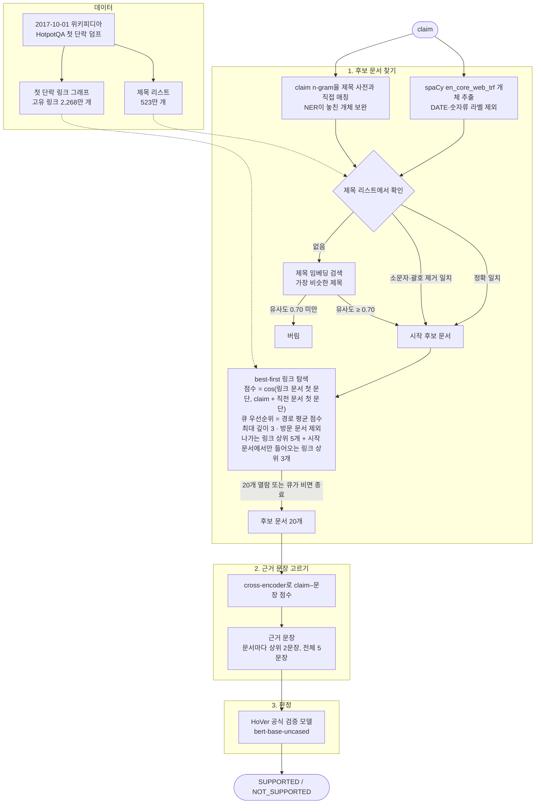
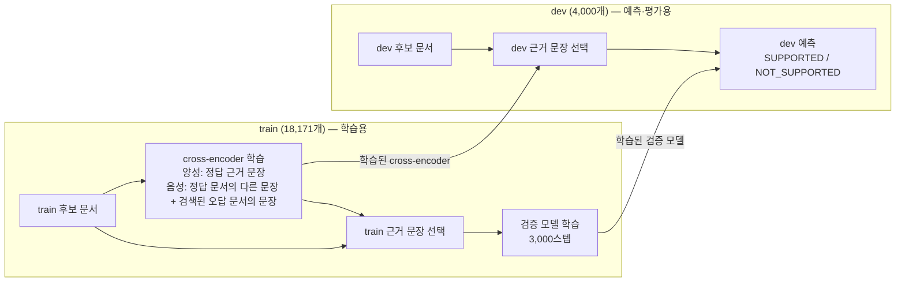

# hover-wiki-graph

[HoVer](https://hover-nlp.github.io/)(그리고 HotpotQA)가 사용한 2017-10-01 위키피디아 스냅숏 기준의
문서 제목 링크 그래프와, HoVer claim 분석 스크립트, 사실 검증 파이프라인 코드입니다.

필요한 것: [uv](https://docs.astral.sh/uv/)로 관리하는 Python 3.11–3.12(`uv sync`), `curl`, `bzip2`, `tar`.
모든 스크립트는 `uv run python ...`으로 실행합니다.

## 그래프

| 그래프 | 노드 | 엣지 | 출처 |
|---|---|---|---|
| 첫 단락 링크 (HoVer 검색 코퍼스) | 5,233,329 | 링크 등장 23,014,264건 | HotpotQA `withlinks-abstracts` 덤프 |
| 본문 전체 링크 | 5,486,204 | 고유 413,594,217개 | `enwiki-20171001-pagelinks.sql.gz` |

링크 대상은 2017-10-01 리다이렉트 표(7,991,447개)로 풀었습니다.
파일 형식과 재생성 명령은 [docs/graph.md](docs/graph.md)에 있습니다.
데이터는 커밋하지 않습니다. 다시 만드는 데 1시간 정도 걸리고, 작업 중 디스크가 최대 약 25GB 필요합니다.

### HoVer 근거 문서 연결 비율 (dev)

HoVer 근거 문서 제목 18,299개는 두 그래프 모두에 노드로 들어 있습니다.

| | 첫 단락 그래프 | 본문 전체 그래프 |
|---|---|---|
| 2-hop: 두 문서가 직접 링크로 연결 | 87.4% | 88.6% |
| 2-hop: 그 링크가 근거 문장에서 출발 | 80.3% | – |
| 3-hop: 근거 문서들이 서로 연결 | 65.4% | 68.7% |
| 4-hop: 근거 문서들이 서로 연결 | 37.2% | 47.2% |

## 스크립트

`scripts/`
- `fetch_ranges.sh` — 끊겨도 이어받는 병렬 구간 다운로드 (표준 출력으로 스트리밍)
- `download_abstracts.sh` — HotpotQA 첫 단락 덤프 다운로드
- `extract_pages.py` — pages-articles XML 덤프에서 ns0 문서·리다이렉트 표 추출
- `build_abstract_graph.py`, `build_full_graph.py` — 그래프 생성
- `validate_graph.py` — HoVer 근거 문서 연결 비율 보고
- `title_utils.py` — 제목 정규화, HTML 엔티티 처리, 리다이렉트 해석
- `make_colab_bundle.py` — 노드·링크·HoVer json을 Colab용 `data/colab_bundle/`로 묶기
- `jscompat.py` — JavaScript와 같은 숫자 포맷·키 순서·JSON 출력 (Node.js에서 옮긴 스크립트들이
  기존 출력과 바이트 단위로 같게 나오도록 함)

`scripts/analysis/` (입력: `hover_{train,dev,test}_release_v1.1.json`이 있는 폴더)
- `dataset_stats.py <data_dir>` — 라벨·hop 분포, 근거 문장·제목 통계
- `claim_mutations.py <data_dir>` — NOT_SUPPORTED claim이 짝이 되는 SUPPORTED claim과 어떻게 다른지
- `claim_logic.py <data_dir> <split> [ex]` — 규칙 기반 claim 논리 구조 분류
- `hop2_structure.py <data_dir> <split> [ex]` — 2-hop claim 세부 구조 분류

분석용 분류기는 정규식 휴리스틱이라 비율은 대략적인 경향으로 봐 주세요.

## 사실 검증 파이프라인

### claim 하나가 판정되기까지



### train과 dev의 쓰임



1. **후보 문서 찾기**: claim에서 개체(spaCy `en_core_web_trf`)와 제목 사전에 있는 n-gram을 뽑아
   제목에 연결합니다(정확 일치 → 소문자·괄호 제거 일치 → 제목 임베딩 검색). 연결된 문서에서 시작해
   첫 단락 링크 그래프를 best-first로 탐색하고, 20개 문서를 엽니다.
2. **근거 문장 고르기**: HoVer train으로 학습한 cross-encoder(정답 근거 문장 vs. 검색된 오답 문서의 문장)로
   후보 문서의 모든 문장에 점수를 매기고, 문서마다 상위 2문장, 전체 5문장을 남깁니다.
3. **판정**: HoVer 공식 레시피(bert-base-uncased, 최대 길이 200, claim ≤ 60토큰, 학습률 3e-5,
   배치 4 × 2, 3,000스텝)로 train에서 고른 근거 문장을 넣어 학습한 모델이 SUPPORTED / NOT_SUPPORTED를 판정합니다.

### 실행 방법

GPU가 필요한 단계라 Colab 노트북으로 돌립니다.

| 노트북 | 하는 일 |
|---|---|
| [colab/hover_retrieval.ipynb](colab/hover_retrieval.ipynb) | 1단계. 설정 셀의 `SPLIT`을 `dev`, `train`으로 바꿔 두 번 실행 |
| [colab/hover_evidence_verify.ipynb](colab/hover_evidence_verify.ipynb) | 2·3단계와 dev 평가 |
| [colab/speed_benchmark.ipynb](colab/speed_benchmark.ipynb) | 공식 베이스라인 재현과의 속도 비교 |

필요한 파일은 Google Drive `MyDrive/hover_bundle/`에 둡니다. `scripts/make_colab_bundle.py`가 만드는
노드·링크·HoVer json과, `retrieval/export_sentences.py`가 만드는 첫 단락 문장 `sents.jsonl.gz`입니다.
결과는 `hover_bundle/results/`, 학습한 모델은 `hover_bundle/models/<검색 설정>/`에 저장됩니다.

2·3단계는 `retrieval/` 스크립트이므로 노트북 없이 직접 실행할 수도 있습니다. `retrieval/build_store.py`로
문장 저장소를 만들고 1단계 결과를 `data/results/`에 둔 뒤 실행합니다. 데이터 폴더는 환경변수 `HOVER_DATA`로 바꿀 수 있습니다.
```
cd retrieval
uv run python sentence_selector.py train  --retrieval ../data/results/train_B20_M5_d3_both_in3d0_floor0.7.jsonl
uv run python sentence_selector.py select --retrieval ../data/results/train_B20_M5_d3_both_in3d0_floor0.7.jsonl
uv run python sentence_selector.py select --retrieval ../data/results/dev_B20_M5_d3_both_in3d0_floor0.7.jsonl
uv run python verifier.py train   --evidence ../data/results/train_B20_M5_d3_both_in3d0_floor0.7.evidence_k2_n5.jsonl
uv run python verifier.py predict --evidence ../data/results/dev_B20_M5_d3_both_in3d0_floor0.7.evidence_k2_n5.jsonl
uv run python evaluate.py --tag B20_M5_d3_both_in3d0_floor0.7   # dev 단계별 성능
```

## HoVer 공식 베이스라인과의 차이

공식 베이스라인은 HoVer 논문([Jiang et al., 2020](https://arxiv.org/abs/2011.03088))과
[hover-nlp/hover](https://github.com/hover-nlp/hover) 저장소 기준입니다. 위키 코퍼스(2017-10-01 HotpotQA 첫 단락)는 같습니다.

| 단계 | HoVer 공식 베이스라인 | 이 파이프라인 |
|---|---|---|
| 문서 후보 생성 | TF-IDF(DrQA, bi-gram)로 문서 검색 | claim 개체(spaCy `en_core_web_trf`, DATE·숫자류 제외) + n-gram 제목 매칭 → 제목 연결(정확 일치 → 소문자·괄호 제거 일치 → 제목 임베딩, 유사도 0.70 미만은 버림) |
| 문서 선택 | TF-IDF 상위 20개를 BERT-base로 재순위 → 상위 5개 문서 | 시작 문서에서 첫 단락 링크 그래프를 best-first 탐색 (MiniLM 임베딩, 최대 깊이 3, 나가는 링크 상위 5개 + 들어오는 링크 상위 3개를 따로 선택) → 20개 문서 |
| 문서 간 연결 | 쓰지 않음 (문서를 독립적으로 점수화) | 위키 하이퍼링크를 따라 숨은 중간 개체(bridge) 문서로 이동 |
| 문장 분리 | Stanford CoreNLP로 실행 시 분리 | HotpotQA 덤프에 저장된 문장 그대로 (HoVer 문장 번호와 일치) |
| 근거 문장 선택 | BERT-base, 상위 5개 문서의 문장 중 임계값을 넘는 문장 | cross-encoder(`ms-marco-MiniLM-L-6-v2`에서 시작해 HoVer train으로 미세조정, 검색된 오답 문서의 문장을 음성으로 사용), 문서마다 상위 2문장, 전체 5문장 고정 |
| 검증 모델 | BERT-base-uncased, 길이 200, claim ≤ 60토큰, 학습률 3e-5, 배치 4 × 2, 3,000스텝 | 같은 레시피 |
| 검증 모델 학습 입력 | BERT+Retr: 파이프라인이 고른 근거 / BERT+Gold: 정답 근거 | 파이프라인이 고른 train 근거 (BERT+Retr 방식) |

## 성능 평가 (dev 4,000개)

> 이 섹션의 표는 나가는 링크만 따라가는 설정(`DIRECTION = "out"`, 결과 태그 `B20_M5_d3_out_floor0.7`)의
> 결과입니다. 들어오는 링크를 함께 따라가는 설정들과의 비교는 아래 [그래프 탐색 설정 비교](#그래프-탐색-설정-비교-dev)에 있습니다.

### 최종 결과 비교

| | 정확도 | HoVer score |
|---|---|---|
| **이 파이프라인** | **66.6** | **18.8** |
| 공식 BERT+Retr (검색 근거로 학습) | 73.7 | 14.5 |
| 공식 BERT+Gold (정답 근거로 학습) | 67.6 | 14.9 |
| 공식 claim만 보고 판정 (근거 없음) | 63.7 | – |
| 공식, 정답 근거를 넣었을 때 (상한) | 81.2 | – |

HoVer score는 논문 정의를 그대로 따릅니다. 라벨이 맞고, 동시에 정답 근거 문서마다 근거 문장을
하나 이상 찾았을 때만 맞힌 것으로 칩니다. 공식 수치는 논문 Table 6·7(dev)입니다.

### 단계별 결과 (%)

| hop | n | 시작 문서 재현율 | 후보 20개 재현율 | 근거 문서 전부 찾음 | 근거 문장 정밀도 | 근거 문장 재현율 | 근거 문장 F1 | 정확도 | macro-F1 | HoVer score |
|---|---|---|---|---|---|---|---|---|---|---|
| 2 | 1,126 | 52.1 | 65.2 | 52.5 | 27.7 | 59.6 | 37.4 | 64.3 | 63.3 | 35.0 |
| 3 | 1,835 | 43.0 | 58.5 | 29.8 | 33.0 | 49.7 | 39.4 | 69.3 | 68.9 | 17.3 |
| 4 | 1,039 | 39.6 | 49.5 | 13.9 | 35.1 | 40.3 | 37.3 | 64.3 | 63.4 | 3.9 |
| 전체 | 4,000 | 44.7 | 58.1 | 32.0 | 32.1 | 50.1 | 38.3 | 66.6 | 66.5 | 18.8 |

- 재현율은 claim마다 정답 근거 문서(또는 문장) 중 찾은 비율의 평균입니다.
- 근거 문장 F1은 claim마다 정답 근거 문장 집합과 선택 문장 집합의 F1을 낸 뒤 평균한 값입니다.
  논문의 공식 문장 선택 F1은 hop별 57.2 / 49.8 / 45.0, 전체 50.6입니다(Table 5).
- 논문의 문서 검색 결과는 상위 5개 문서의 EM/F1이라(Table 4), 위 표의 재현율과 바로 비교할 수 없습니다.

### hop별 정확도 비교

| hop | 이 파이프라인 | 공식 claim만 (근거 없음) | 차이 | 공식, 정답 근거 (상한) |
|---|---|---|---|---|
| 2 | 64.3 | 57.5 | +6.8 | 79.8 |
| 3 | 69.3 | 67.7 | +1.6 | 83.5 |
| 4 | 64.3 | 63.6 | +0.7 | 78.6 |
| 전체 | 66.6 | 63.7 | +2.9 | 81.2 |

### 해석

1. **근거 문장은 공식보다 잘 찾습니다.** HoVer score가 18.8로 공식(14.5~14.9)보다 높습니다.
   특히 2-hop은 정답 근거 문서를 전부 찾는 비율이 52.5%입니다.
2. **판정 정확도는 공식보다 낮고, claim만 보고 판정한 수준(63.7)과 큰 차이가 없습니다.**
   3·4-hop은 claim만 쓴 결과보다 1~2%p 높을 뿐이라, 검증 모델이 근거보다 claim 문장 자체의 패턴에
   기대고 있습니다.
3. **가장 큰 병목은 후보 문서 검색입니다.** 개체로 찾은 시작 문서가 정답 문서의 44.7%만 포함하고,
   그래프 탐색으로 13%p를 더 찾는 데 그칩니다. 그래서 정답 근거 문서를 전부 찾은 claim이 3-hop 29.8%,
   4-hop 13.9%뿐이고, 이 claim들에서는 검증 모델이 쓸 근거가 부족합니다.
4. **근거 문장 정밀도가 낮습니다(32%).** 정답 근거는 claim당 평균 3.4문장인데 항상 5문장을 넣기 때문입니다.

### 주의할 점

- train 근거 문장은 이전 실행의 cross-encoder로 고른 것이고, 최종 cross-encoder는 같은 시드·데이터로
  다시 학습한 것이라 조금 다를 수 있습니다.
- 공식 수치는 논문 보고값이고, 이 저장소에서 공식 코드를 다시 돌린 결과가 아닙니다.

### 그래프 탐색 설정 비교 (dev)

`out` 결과에서 2-hop 정답 문서를 놓친 경우의 22%는 숨은 문서가 시작 문서로만 링크를 걸고 있어
나가는 링크만으로는 닿을 수 없었습니다. 이를 고치려고 들어오는 링크를 추가한 두 설정을 비교했습니다.
예산(B=20), 나가는 링크 상위 5개, 나머지 단계는 모두 같습니다.

| 설정 | 결과 태그 | 들어오는 링크 |
|---|---|---|
| ① out | `B20_M5_d3_out_floor0.7` | 따라가지 않음 |
| ② both_in3 | `B20_M5_d3_both_in3_floor0.7` | 모든 깊이에서 문서마다 상위 3개 |
| ③ both_in3d0 | `B20_M5_d3_both_in3d0_floor0.7` | 시작 문서에서만 상위 3개 (`IN_MAX_DEPTH = 0`) |

| (%) | ① out | ② both_in3 | ③ both_in3d0 |
|---|---|---|---|
| 후보 20개 재현율 (R@20) | 58.1 | 56.8 | **59.6** |
| 정답 근거 문서 전부 찾음 | 32.0 | 29.3 | **32.3** |
| 근거 문장 F1 | 38.3 | 36.3 | **38.8** |
| 정답 문서마다 근거 문장이 하나 이상 있음 | 25.7 | 23.3 | **26.2** |
| 정확도 | **66.6** | 65.4 | 65.5 |
| HoVer score | **18.8** | 15.8 | 17.5 |

hop별 (R@20 / 정답 문서마다 근거 문장 있음 / HoVer score):

| hop | ① out | ② both_in3 | ③ both_in3d0 |
|---|---|---|---|
| 2 | 65.2 / 49.7 / 35.0 | 68.0 / 49.6 / 33.2 | **69.6 / 55.6 / 36.4** |
| 3 | 58.5 / **22.7 / 17.3** | 55.4 / 17.8 / 12.3 | **58.6** / 19.7 / 13.4 |
| 4 | 49.5 / 4.7 / 3.9 | 47.2 / 4.6 / 3.1 | **50.7 / 5.6 / 4.3** |

- **②**는 문서를 열 때마다 들어오는 링크 후보가 3개씩 늘어, 20개 예산을 그쪽에 쓰는 바람에 3·4-hop이 나빠졌습니다.
- **③**은 2-hop을 가장 크게 개선했습니다(정답 문서마다 근거 문장이 있는 비율 +5.9%p). 하지만 시작 문서에서
  추가한 후보(claim당 약 11개)가 예산 일부를 써서 3-hop 근거 커버가 3%p 떨어졌고, 3-hop이 가장 많아
  전체 HoVer score는 ①보다 1.3%p 낮습니다.
- 정확도 차이(1%p 안팎)는 실행마다 검증 모델을 새로 학습한 시드 하나짜리 결과라 실행 간 편차일 수 있습니다.
  HoVer score와 근거 커버는 검색 결과로 거의 정해져 더 믿을 만합니다.
- 다음 후보: 시작 문서의 들어오는 링크를 1개로 줄이거나, 예산을 25개로 늘려 2-hop 이득을 지키면서 3-hop 손실을 줄이기.

## 데이터

HoVer 데이터: <https://hover-nlp.github.io/> (CC BY-SA 4.0). 위키피디아 본문은 CC BY-SA입니다.
