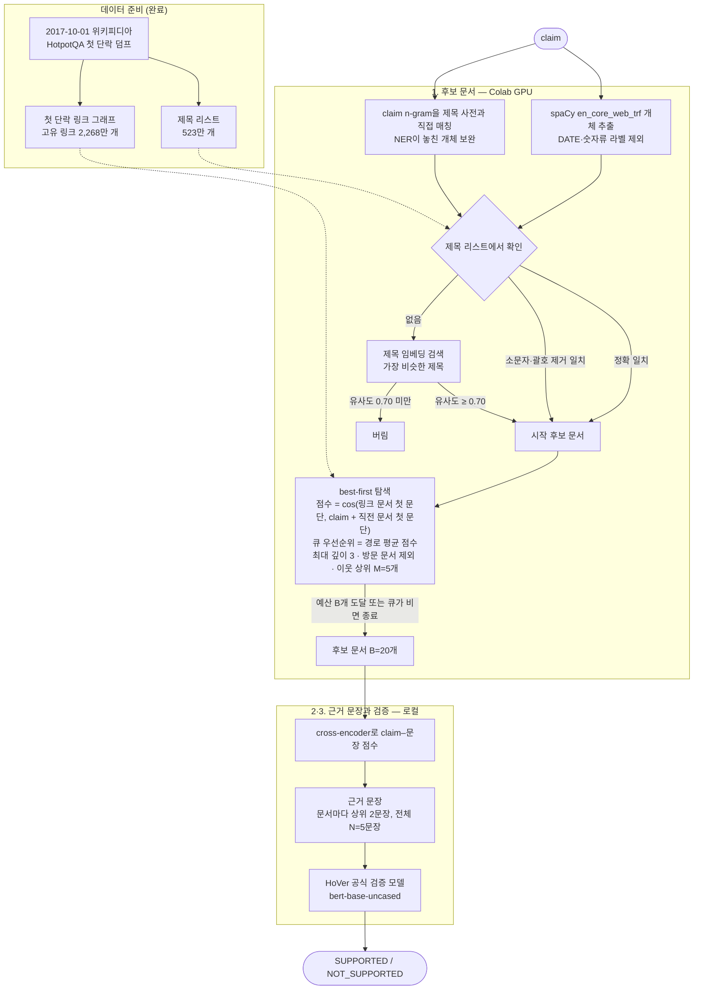
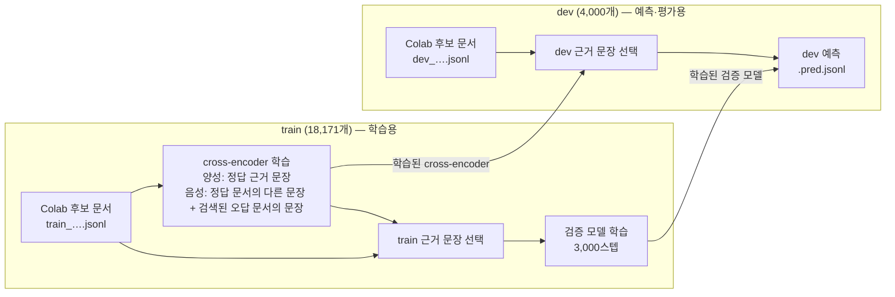

# hover-wiki-graph

[HoVer](https://hover-nlp.github.io/)(그리고 HotpotQA)가 사용한 2017-10-01 위키피디아 스냅숏 기준의
문서 제목 링크 그래프와, HoVer claim 분석 스크립트, 사실 검증 파이프라인 코드입니다.

필요한 것: [uv](https://docs.astral.sh/uv/)로 관리하는 Python 3.11–3.12(`uv sync`), `curl`, `bzip2`, `tar`.
모든 스크립트는 `uv run python ...`으로 실행합니다.

## 그래프

| 그래프 | 노드 | 엣지 | 출처 |
|---|---|---|---|
| 첫 단락 링크 (HoVer 검색 코퍼스) | 5,233,329 | 링크 등장 23,014,264건 | HotpotQA `withlinks-abstracts` 덤프 |
| 본문 전체 링크 | 5,486,204 | 고유 413,594,217개 | `enwiki-20171001-pagelinks.sql.gz` |

링크 대상은 2017-10-01 리다이렉트 표(7,991,447개)로 풀었습니다.
파일 형식과 재생성 명령은 [docs/graph.md](docs/graph.md)에 있습니다.
데이터는 커밋하지 않습니다. 다시 만드는 데 1시간 정도 걸리고, 작업 중 디스크가 최대 약 25GB 필요합니다.

### HoVer 근거 문서 연결 비율 (dev)

HoVer 근거 문서 제목 18,299개는 두 그래프 모두에 노드로 들어 있습니다.

| | 첫 단락 그래프 | 본문 전체 그래프 |
|---|---|---|
| 2-hop: 두 문서가 직접 링크로 연결 | 87.4% | 88.6% |
| 2-hop: 그 링크가 근거 문장에서 출발 | 80.3% | – |
| 3-hop: 근거 문서들이 서로 연결 | 65.4% | 68.7% |
| 4-hop: 근거 문서들이 서로 연결 | 37.2% | 47.2% |

## 스크립트

`scripts/`
- `fetch_ranges.sh` — 끊겨도 이어받는 병렬 구간 다운로드 (표준 출력으로 스트리밍)
- `download_abstracts.sh` — HotpotQA 첫 단락 덤프 다운로드
- `extract_pages.py` — pages-articles XML 덤프에서 ns0 문서·리다이렉트 표 추출
- `build_abstract_graph.py`, `build_full_graph.py` — 그래프 생성
- `validate_graph.py` — HoVer 근거 문서 연결 비율 보고
- `title_utils.py` — 제목 정규화, HTML 엔티티 처리, 리다이렉트 해석
- `make_colab_bundle.py` — 노드·링크·HoVer json을 Colab용 `data/colab_bundle/`로 묶기
- `jscompat.py` — JavaScript와 같은 숫자 포맷·키 순서·JSON 출력 (Node.js에서 옮긴 스크립트들이
  기존 출력과 바이트 단위로 같게 나오도록 함)

`scripts/analysis/` (입력: `hover_{train,dev,test}_release_v1.1.json`이 있는 폴더)
- `dataset_stats.py <data_dir>` — 라벨·hop 분포, 근거 문장·제목 통계
- `claim_mutations.py <data_dir>` — NOT_SUPPORTED claim이 짝이 되는 SUPPORTED claim과 어떻게 다른지
- `claim_logic.py <data_dir> <split> [ex]` — 규칙 기반 claim 논리 구조 분류
- `hop2_structure.py <data_dir> <split> [ex]` — 2-hop claim 세부 구조 분류

분석용 분류기는 정규식 휴리스틱이라 비율은 대략적인 경향으로 봐 주세요.

## 사실 검증 파이프라인

### claim 하나가 판정되기까지



### train과 dev의 쓰임



1. **후보 문서 (Colab, GPU)** — [colab/hover_retrieval.ipynb](colab/hover_retrieval.ipynb):
   spaCy `en_core_web_trf` 개체 + claim n-gram → 제목 연결(정확 일치 → 소문자·괄호 제거 일치 →
   제목 임베딩 검색) → 첫 단락 링크 그래프 best-first 탐색. 결과는 `results/<split>_B20_….jsonl`.
2. **근거 문장 (로컬)** — `retrieval/sentence_selector.py`: HoVer train으로 학습한 cross-encoder
   (정답 근거 문장 vs. 검색된 오답 문서의 문장). 문서마다 상위 2문장, 전체 N문장까지 남깁니다.
3. **검증 (로컬)** — `retrieval/verifier.py`: HoVer 공식 레시피(bert-base-uncased, 최대 길이 200,
   claim ≤ 60토큰, 학습률 3e-5, 배치 4 × 2, 3,000스텝)로 train에서 고른 근거 문장을 넣어 학습합니다.

`retrieval/build_store.py`는 `data/store/wiki.db`(HoVer 문장 번호와 같은 첫 단락 문장)를 만듭니다.
Colab 결과를 `data/results/`에 넣은 뒤 아래 순서로 실행합니다.
```
cd retrieval
uv run python sentence_selector.py train  --retrieval ../data/results/train_B20_M5_d3_out_floor0.7.jsonl
uv run python sentence_selector.py select --retrieval ../data/results/train_B20_M5_d3_out_floor0.7.jsonl
uv run python sentence_selector.py select --retrieval ../data/results/dev_B20_M5_d3_out_floor0.7.jsonl
uv run python verifier.py train   --evidence ../data/results/train_B20_M5_d3_out_floor0.7.evidence_k2_n5.jsonl
uv run python verifier.py predict --evidence ../data/results/dev_B20_M5_d3_out_floor0.7.evidence_k2_n5.jsonl
```

## 데이터

HoVer 데이터: <https://hover-nlp.github.io/> (CC BY-SA 4.0). 위키피디아 본문은 CC BY-SA입니다.
